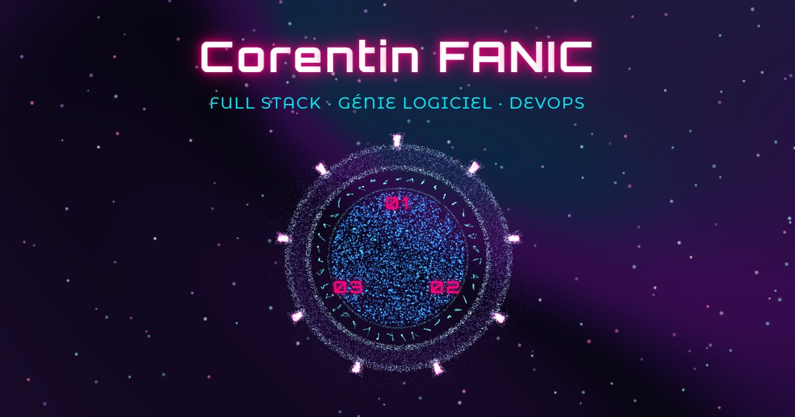

# Corentin FANIC — Portfolio V3

Vitrine cyberpunk d'un développeur full stack : une porte des étoiles en guise de menu, un convecteur temporel pour se présenter, une carte d'accès holographique pour télécharger le CV, et une trajectoire en feu pour suivre les projets. Le CV, les projets et LinkedIn restent à deux clics, quel que soit l'effet affiché.

**En ligne : [corentinfanic.dev](https://corentinfanic.dev)**



## Les pages

| Page | Ce qu'on y trouve |
|------|-------------------|
| Accueil | Le nom se décode puis s'allume comme un tube néon, les rôles se décodent l'un en l'autre. Derrière : une nébuleuse animée et un ciel d'étoiles (étoiles filantes, comète). Au centre : une porte des étoiles d'environ 27 000 particules en WebGL natif, qui sert de menu ; choisir une destination verrouille les chevrons, ouvre l'horizon des événements et plonge dans l'hyperespace. |
| À propos | Un convecteur temporel façon *Retour vers le futur* : trois lignes d'afficheurs 7 segments (passé, présent à l'heure réelle, futur) servent d'onglets ; choisir une époque lance la séquence 88 mph et affiche le texte correspondant. |
| Compétences | La HoloCard, badge d'accès holographique en 3D : elle s'incline à la souris, au doigt et au gyroscope (Android), se retourne (verso avec le QR du profil LinkedIn) et télécharge le CV. Les technologies sont reliées aux projets qui les utilisent. |
| Projets | Une frise chronologique dont l'axe brûle au fil du défilement, chaque année sur un afficheur 7 segments, et des fiches présentées en fenêtre de démo avec leurs liens Démo et Code. |

Entre les pages : une barre « ligne d'horizon » (en bas de l'écran sur une tablette tenue debout), une transition « hyperespace » entre l'accueil et les pages, et « 88 mph » d'une page à l'autre.

## Stack

| Domaine | Choix |
|---------|-------|
| Interface | React 19, TypeScript 5.7 en mode strict |
| Routage | React Router 7 (`createBrowserRouter`) ; About, Skills et Projects chargées à la demande |
| Build | Vite 6, puis un post-traitement maison (`scripts/postbuild.mjs`) |
| Styles | SCSS Modules (Dart Sass, `@use`), jetons de couleur et points de rupture centralisés |
| Animation | motion 14 (`motion/react`) et `@keyframes` CSS |
| Rendu | WebGL natif (la porte), Canvas 2D (ciel, circuit, flamme, QR), Paper Shaders (la nébuleuse) |
| Tests | Vitest 5 |
| Hébergement | GitHub Pages, déployé par GitHub Actions |

## Lancer le projet en local

Prérequis : Node.js 22.12 ou plus récent (Node 24 LTS conseillé, c'est celui de la CI) et npm.

```bash
npm ci
npm run dev
```

Le site de développement s'ouvre sur `http://localhost:5173`. Pour juger du rendu réel (performances comprises), passer par le build de production :

```bash
npm run build
npm run preview
```

## Scripts

| Commande | Rôle |
|----------|------|
| `npm run dev` | Serveur de développement Vite. |
| `npm run build` | Vérification des types (`tsc`), `vite build`, puis `scripts/postbuild.mjs` : une page HTML par route avec son titre, sa description et ses balises Open Graph, le préchargement du code et de la feuille de style de la page, et `sitemap.xml`. |
| `npm run preview` | Sert le dossier `dist` (build de production). |
| `npm run lint` | ESLint, aucun avertissement toléré. |
| `npm test` | Tests Vitest. |
| `npm run gen:assets` | Régénère `src/data/generated/` : les logos (Simple Icons) des seules compétences listées dans `content.ts`, et la matrice du QR LinkedIn. À lancer après avoir changé une compétence ou le lien LinkedIn. |
| `npm run gen:visuals` | Capture les démos en ligne des projets et dessine les visuels des projets sans démo (`src/assets/projects/`, en WebP). |
| `npm run gen:og` | Régénère l'image de partage `public/og-image.jpg` (1200×630) à partir de l'accueil, après `npm run build`. |

Les trois générateurs pilotent Chrome ou Edge en mode headless par le protocole DevTools : aucune dépendance supplémentaire.

## Déploiement

Chaque push sur `main` déclenche `.github/workflows/deploy.yaml` : installation par `npm ci` sous Node 24, build, copie d'`index.html` en `404.html` (une adresse inconnue retombe sur l'application, qui affiche sa page 404), puis publication sur GitHub Pages. Le site est servi sur `corentinfanic.dev`, en HTTPS forcé ; `www.corentinfanic.dev` et l'ancienne adresse GitHub Pages redirigent vers lui.

Aucun push direct sur `main` : chaque évolution passe par une branche et une pull request.

## Structure du code

```text
src/
├── components/   atomic design : atoms (fonds animés, icônes), molecules (titres décodés, fiches),
│                 organisms (porte, barre, convecteur, HoloCard, frise…), templates (mise en page, transitions)
├── pages/        Home, About, Skills, Projects, NotFound
├── data/         content.ts (tous les textes), effects.ts (réglages des effets), breakpoints.ts,
│                 seo.json, projectVisuals.json, generated/ (logos, QR)
├── hooks/        useTravel (canal des transitions), useAnimationLoop, useDevice, useIdleReady…
├── utils/        logique pure, sans React ni DOM, testée : circuit, ciel, porte, convecteur, flamme…
├── webgl/        compilation des programmes WebGL
├── styles/       jetons, points de rupture, mixins, styles globaux
└── types/        modèle des données (models.ts)
scripts/          post-traitement du build et générateurs (logos, QR, visuels, image de partage)
public/           CV, favicon, image de partage, robots.txt
```

Quelques règles tiennent l'ensemble : aucun texte affiché ailleurs que dans `src/data/content.ts`, aucun réglage d'effet ailleurs que dans `src/data/effects.ts`, des points de rupture définis une seule fois (`src/styles/_breakpoints.scss`, reflété dans `src/data/breakpoints.ts`), et des boucles de rendu sans allocation, en pause hors écran.

## Qualité

- **Accessibilité** : tout se fait au clavier avec un focus visible, les cibles tactiles mesurent au moins 44 px, les contrastes sont AA (mesurés en couleurs pleines) et le décor est masqué aux lecteurs d'écran. Le mouvement réduit est respecté partout : fonds en image fixe, transitions en fondu court, aucune animation en boucle.
- **Responsive** : téléphone (moins de 600 px), tablette en portrait (barre en bas, sous le pouce) et en paysage, bureau ; vérifié de 375 à 1 440 px, au doigt comme à la souris, sans débordement horizontal.
- **Navigateurs** : Chrome, Edge, Firefox et Safari (moteur WebKit), en versions actuelles. Le parcours complet, le téléchargement du CV, les liens des projets, le clavier et le mouvement réduit y sont vérifiés par de vrais gestes (Playwright).
- **Code** : TypeScript strict, ESLint sans avertissement, 225 tests Vitest sur la logique pure.
- **Vie privée** : aucun cookie, aucun traceur, aucune donnée collectée ; aucune coordonnée personnelle sur le site (elles sont dans le CV).

Performances mesurées par Lighthouse 13.5 sur le site en ligne (octobre 2026), score de performance :

| Profil | Accueil | À propos | Compétences | Projets |
|--------|---------|----------|-------------|---------|
| Mobile | 98 | 95–97 | 92–94 | 97 |
| Tablette (768×1024) | 98 | 95–98 | 96 | 96–97 |
| Bureau | 100 | 100 | 100 | 100 |

Accessibilité, bonnes pratiques et SEO : 100 sur toutes les pages, dans tous les profils.

## Crédits et licences

| Source | Usage | Licence |
|--------|-------|---------|
| [Paper Shaders](https://shaders.paper.design) (`@paper-design/shaders` 0.0.81) | Shader « mesh gradient » de la nébuleuse, utilisé sans modification ; compilation WebGL dérivée de leur `createProgram` | Apache-2.0. Mention de leur fichier NOTICE : « Paper Shaders, Copyright 2026 Paper. Powered by Paper Shaders: https://shaders.paper.design » |
| DSEG7 et DSEG14 Classic, de keshikan | Afficheurs 7 et 14 segments (convecteur, frise des projets) | SIL Open Font License 1.1 ([`src/assets/fonts/dseg/DSEG-LICENSE.txt`](src/assets/fonts/dseg/DSEG-LICENSE.txt)), fichiers non modifiés, « DSEG » étant un nom de police réservé |
| Orbitron et Montserrat Alternates, via Fontsource | Polices du site | SIL Open Font License 1.1 |
| [Simple Icons](https://simpleicons.org) 16.34 | Logos des technologies, générés par `gen:assets` | CC0-1.0 ; les logos restent des marques de leurs propriétaires |
| qrcode-generator 2.0.4 | Matrice du QR LinkedIn, générée par `gen:assets` | MIT |
| React, React Router, motion, Vite, Vitest, Sass | Bibliothèques et outillage | MIT |
| TypeScript | Langage | Apache-2.0 |

Les visuels des projets sont des captures des démos de l'auteur, ou des illustrations dessinées pour ce site.

## Licence

Tous droits réservés. Le code, les textes, le CV, les captures et les visuels appartiennent à Corentin FANIC et ne peuvent être réutilisés sans son accord écrit. Les sources externes citées ci-dessus restent sous leur propre licence.
